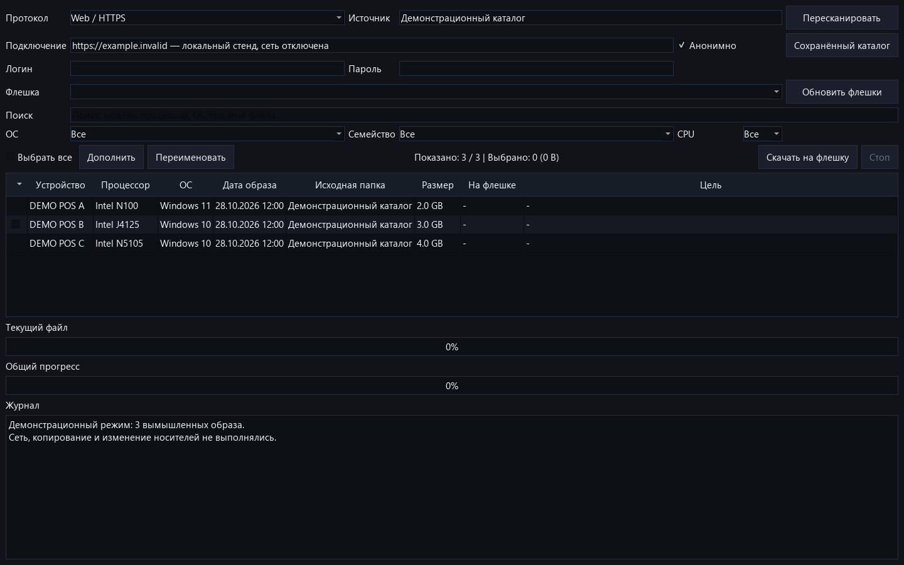

# Acronis Image Tool

**Найдите нужный образ и скопируйте его на флешку.** Каталогизатор файлов TIB и TIBX для Windows: сетевые источники, фильтры по оборудованию и ОС, проверка наличия на носителе и копирование с прогрессом.

[**Скачать для Windows x64**](https://github.com/jeronimo701/AcronisImageTool/releases/download/release-2026-11-23/AcronisImageTool-Setup-2026-11-23.exe) · [Описание выпуска](https://github.com/jeronimo701/AcronisImageTool/releases/tag/release-2026-11-23) · [Подробная инструкция](DETAILS.ru.md)

*Окно приложения с тремя вымышленными образами. На снимке нет рабочих подключений; сеть и запись на носители при съёмке отключены.*

## От каталога до флешки

| Шаг | Что делать |
|---|---|
| **1. Подключить источник** | Выберите SMB, FTP или Web / HTTPS. Для публичного каталога POScenter учётная запись не нужна. |
| **2. Найти образ** | Ищите по модели, процессору, ОС или имени файла. Используйте фильтры по ОС, семейству оборудования и CPU. |
| **3. Проверить выбор** | Посмотрите размер, дату образа и наличие файла на выбранной флешке. |
| **4. Скопировать** | Отметьте образы и нажмите «Скачать на флешку». Прогресс текущего файла и всей очереди виден в окне. |

Список файлов можно сохранить и открыть позже без повторного сетевого сканирования. Описание образа можно уточнить локально; изменения хранятся отдельно от файлов источника.

## Скачать и запустить

1. Скачайте **AcronisImageTool-Setup-2026-11-23.exe** из [релиза](https://github.com/jeronimo701/AcronisImageTool/releases/tag/release-2026-11-23).
2. Выберите папку с правом записи. Установщик распакует переносимую сборку без прав администратора.
3. Запустите **AcronisImageTool.exe**. Python устанавливать не нужно.
4. Для переноса на другой компьютер копируйте папку целиком, включая **_internal**.

При обновлении закройте приложение и сохраните свои настройки и каталоги. Выпуск от 23 ноября содержит ту же проверенную сборку приложения от 28 октября 2026 года с обновлённой документацией и упаковкой; новые функции в нём не заявлены.

## Где хранятся данные

| Файл или папка | Содержимое |
|---|---|
| app_settings.json | Подключения и реквизиты; сохраняются открытым текстом, не передавайте файл другим людям. |
| catalogs/ | Сохранённые списки образов. |
| metadata_overrides.json | Ручные уточнения описаний. |

Публичная поставка не содержит пользовательских настроек, рабочих каталогов и самих образов ОС. При первом использовании приложение создаст нужные локальные файлы.

## Разработка и поддержка

[Исходники, тесты и сборка](DETAILS.ru.md) · [Сообщить о проблеме](https://github.com/jeronimo701/AcronisImageTool/issues)

Проверены комплектность установщика, три автоматических теста и запуск интерфейса. Реальное копирование на физические носители в этой публикации не проверялось.

Автор — **Jeronimo701**. [Лицензия авторского кода](LICENSE.txt) · [Область лицензии](LICENSE-SCOPE.md) · [Сторонние компоненты](THIRD-PARTY.md).

Приложение работает с файлами образов, не восстанавливает их на диски и не включает ПО Acronis. Право использования самих образов определяется владельцем источника.
