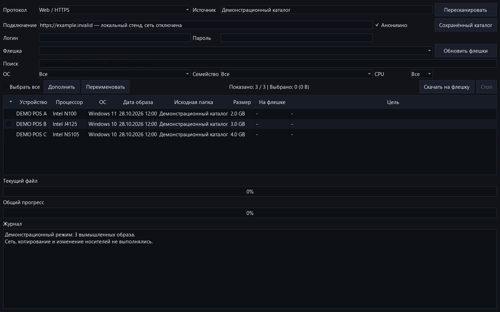

# Acronis Image Tool

Каталог образов `.tib` и `.tibx` для Windows: найди нужное устройство, выбери образы и скопируй их на флешку — без ручного обхода сетевых папок.

[Скачать для Windows](https://github.com/jeronimo701/AcronisImageTool/releases) · [Подробная инструкция](DETAILS.ru.md) · [Сообщить об ошибке](https://github.com/jeronimo701/AcronisImageTool/issues)

*Настоящее окно приложения с вымышленными образами на локальном стенде. Сеть и запись на носители при съёмке отключены.*

## Возможности

- SMB, FTP и публичный Web/HTTPS-каталог POScenter.
- Поиск по модели, процессору, ОС и имени файла; фильтры по ОС, семейству и CPU, дата образа в таблице.
- Сохранённый каталог и локальные уточнения описаний.
- Проверка наличия образов на выбранном носителе.
- Копирование выбранных файлов с прогрессом и остановкой.

## Быстрый старт

1. В [Releases](https://github.com/jeronimo701/AcronisImageTool/releases) скачай `AcronisImageTool-Setup-snapshot-2026-10-28.exe`.
2. Распакуй комплект в папку с правом записи и запусти `AcronisImageTool.exe`. Python устанавливать не нужно.
3. Выбери источник. Для первого знакомства доступен публичный каталог POScenter; для SMB/FTP укажи свои реквизиты.
4. Обнови каталог, найди образы и выбери целевую флешку. Проверь список перед копированием.

Приложение **не восстанавливает образы на диски** и не включает Acronis или сами образы ОС.

## Данные и статус

Реквизиты подключения сохраняются локально в `app_settings.json` **открытым текстом**. Не отправляй его в issues. Каталоги находятся в `catalogs/`, ручные описания — в `metadata_overrides.json`. Публичная поставка не содержит рабочих данных.

Текущий выпуск — предварительный снимок от 28 октября 2026 года, не новая пронумерованная стабильная версия. Доступ к чужим образам и право их использования определяются владельцем источника.

## Разработка и лицензии

Python + PySide6; установка зависимостей, тесты и сборка описаны в [DETAILS.ru.md](DETAILS.ru.md). В этой доработке документации проверен рендер окна на демонстрационных данных, а не реальное SMB/FTP-копирование.

Автор — **Jeronimo701**. Условия собственного кода: [LICENSE.txt](LICENSE.txt), [LICENSE-SCOPE.md](LICENSE-SCOPE.md). Сторонние компоненты: [THIRD-PARTY.md](THIRD-PARTY.md). Проект не является продуктом Acronis.
